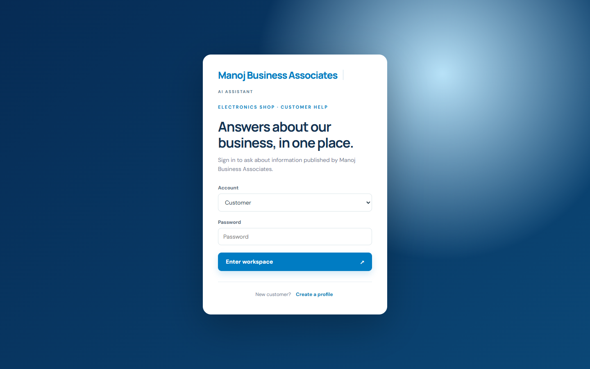
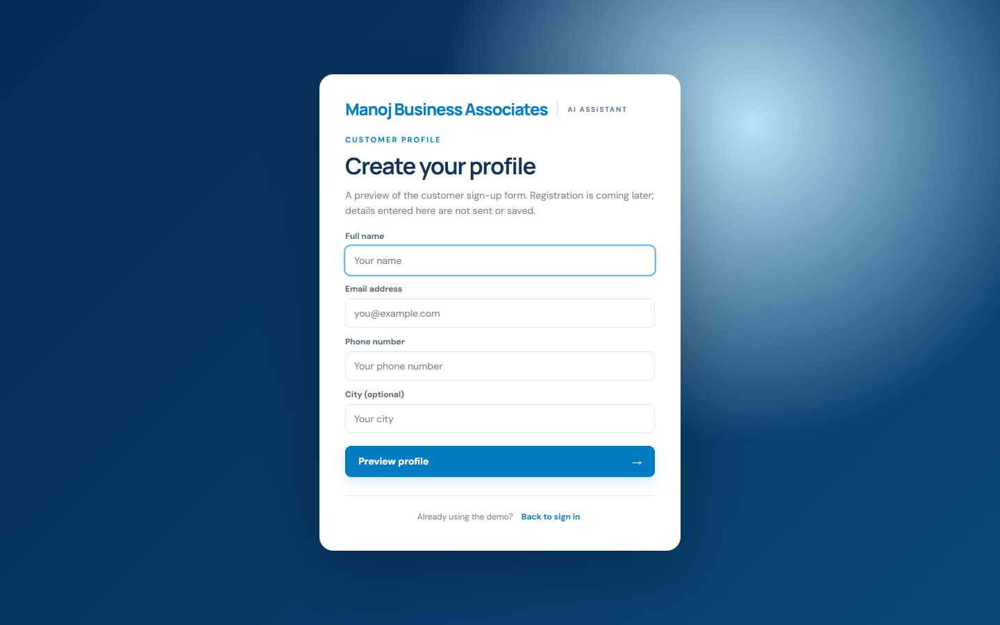
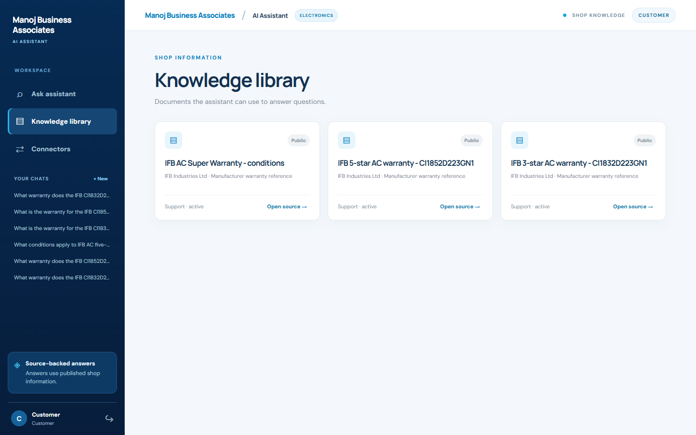
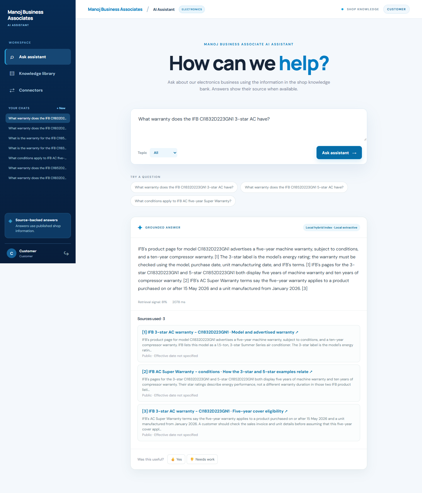
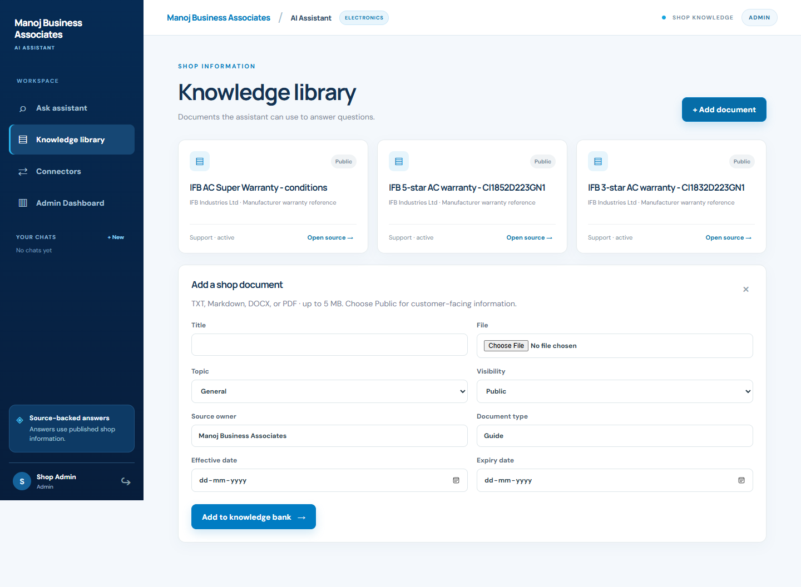
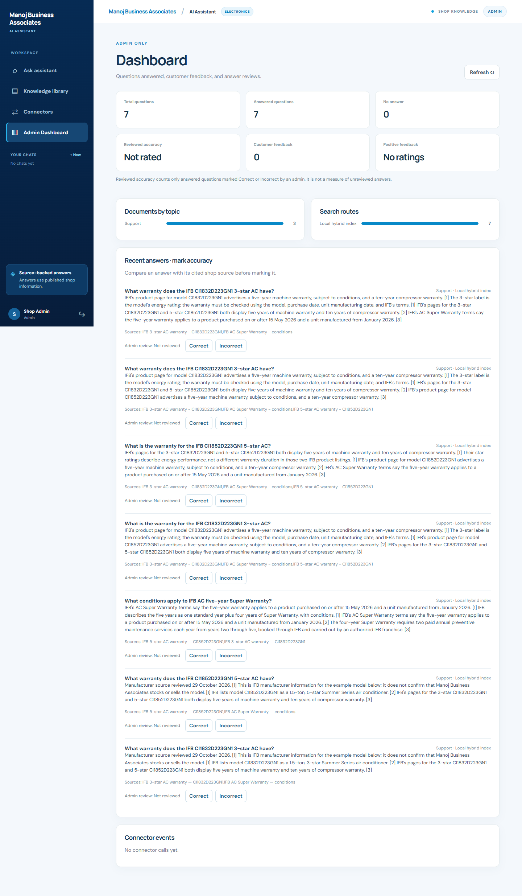

# Manoj Business Associate AI assistant

## Project overview

A document-backed assistant for Manoj Business Associates, an electronics items shop. Customers ask about information the shop has published. An Admin adds documents and reviews questions, feedback, and answer quality in a Dashboard. The assistant cites its source when the knowledge bank supports an answer and says when it lacks enough information.

## Business problem and product goal

Customers may need answers about products, orders, or support while shop information is scattered across files. The goal is to provide a simple question box with source-backed answers, a way for the Admin to update the knowledge bank, and a Dashboard that shows where answers need review. The app should not invent prices, stock, warranty terms, or return rules.

## Current status and live demo

The current version is on the `manoj-app` branch, which is the repository's default branch. The [earlier Render deployment](https://infosys-enterprise-gpt-demo.onrender.com/) still follows the old `main` branch and shows the previous enterprise demo until this version is deployed with its required environment variables.

The app starts with three Public IFB manufacturer warranty references: a 3-star AC example, a 5-star AC example, and the shared Super Warranty conditions. The source files are in [data/ifb_reference](data/ifb_reference) and are indexed once on first startup. Admin can add or archive documents afterward. Questions without supporting documents receive an insufficient-evidence answer.

## Screenshots

| Sign-in | Customer profile preview |
| --- | --- |
|  |  |

| IFB knowledge library | Cited warranty answer |
| --- | --- |
|  |  |

| Admin document upload | Admin Dashboard |
| --- | --- |
|  |  |

## Roles and key features

| Role | Permissions |
| --- | --- |
| Customer | Ask questions, read Public documents and citations, and rate an answer. |
| Admin | Also upload or archive documents, read Admin-only documents, view the Dashboard, and mark answered questions Correct or Incorrect. |

The UI hides Admin controls from Customers; the backend checks permissions again on API requests. Admin and Customer use separate passwords. The Customer profile page is a visual preview: submitting it sends and saves nothing, and does not create an account.

## Demo sign-in

| Role | Account | Password |
| --- | --- | --- |
| Customer | `customer@demo.local` | `Customer123!` |
| Admin | `admin@demo.local` | `Almax!23` |

These are public demo credentials. Replace both passwords before using real shop or customer data in a shared deployment.

The app supports TXT, Markdown, DOCX, and text-readable PDF upload; document indexing; duplicate detection; product-question routing through a read-only local MCP tool; optional Gemini answers; a local cited fallback; and a clear no-answer path.

## Architecture

    Customer or Admin -> browser -> app.py API -> SQLite users/sessions/chats
                                      |
                             knowledge.py role checks
                                      |
                Qdrant chunk embeddings + SQLite FTS5 terms
                                      |
                   product MCP tool or local retrieval
                                      |
                            permitted passages
                                      |
                         Gemini or local cited answer
                                      |
                  feedback and Admin review -> Dashboard

The browser sends JSON requests to app.py. SQLite holds accounts, sessions, chats, document text and metadata, questions, feedback, and reviews. Qdrant stores chunk embeddings for semantic retrieval; SQLite FTS5 adds keyword ranking. Product questions demonstrate an MCP tool call against the same knowledge bank. The model, when configured, receives only passages allowed for the signed-in role. See [architecture notes](docs/architecture.md).

## AI workflow

1. The Admin uploads a shop document and chooses its topic and visibility.
2. The backend extracts text, splits it into overlapping passages, embeds each passage with FastEmbed's `BAAI/bge-small-en-v1.5` model, and stores the 384-dimensional embeddings in Qdrant. It also indexes passage text in SQLite FTS5.
3. A Customer asks a question. Simple keyword rules select Products, Orders, Support, or General, unless the user selects a topic.
4. The question gets an embedding. Qdrant finds nearby passage vectors, while SQLite FTS5 helps rank keyword matches. Search keeps only active, unexpired, permitted passages. Product questions may use the local MCP tool; the backend rechecks its results.
5. If the passages are too weak, the assistant says it cannot confirm the answer. Otherwise Gemini may write a cited answer, with a local sentence-selection fallback.
6. The question, route, citations, customer feedback, and Admin review feed the Dashboard.

The retrieval signal is a hybrid search ranking score, not a probability of correctness. Reviewed accuracy is the percentage of reviewed answered questions marked Correct by an Admin. Unreviewed answers are excluded.

## Data sources

The local bank contains three summaries in [data/ifb_reference](data/ifb_reference), based on IFB's official pages for the [3-star CI1832D223GN1](https://www.ifbappliances.com/ci1832d223gn1), [5-star CI1852D223GN1](https://www.ifbappliances.com/ci1852d223gn1), and [AC Super Warranty terms](https://www.ifbappliances.com/ac-super-warranty-terms-and-conditions). Both example product pages display five years of machine cover and ten years for the compressor. IFB's terms say the five-year cover applies only to products purchased on or after 15 May 2026 and units manufactured from January 2026, with service and other conditions. These references do not establish that this shop stocks either model.

The three shipped IFB references are indexed once for each database; archiving one will not bring it back on the next restart. Admin uploads remain available across local restarts, and the Admin can add more TXT, Markdown, DOCX, and text-readable PDF documents from Knowledge library. Earlier enterprise demo documents are archived and removed from active vector retrieval when an existing database is migrated; previous chat and review records are kept.

### Add another document

1. Sign in as Admin, open **Knowledge library**, and select **+ Add document**.
2. Enter a title and choose a TXT, Markdown, DOCX, or text-readable PDF file (up to 5 MB). Select a topic and **Public** visibility if Customers should be able to use it.
3. Select **Add to knowledge bank**. The backend extracts text, creates searchable chunks and embeddings, and adds the document to the library. Customers can then ask about the new information. Scanned image-only PDFs need OCR before upload.

For the current IFB references, try: “What warranty does the IFB CI1832D223GN1 3-star AC have?”, “What warranty does the IFB CI1852D223GN1 5-star AC have?”, or “What conditions apply to IFB AC five-year Super Warranty?”

## Tools and technologies

| Part | Technology | Job |
| --- | --- | --- |
| Frontend | HTML, CSS, JavaScript in static/ | Login, assistant, library, connector view, Dashboard. |
| Backend | Python standard-library HTTP server in app.py | Sessions, roles, API, query workflow, reviews. |
| SQL database | SQLite and FTS5 in knowledge.py | Accounts, token hashes, chats, questions, document records, feedback, reviews, and keyword search. |
| Embedding model | FastEmbed, `BAAI/bge-small-en-v1.5` | Local 384-dimensional embeddings for document passages and questions. |
| Vector database | Qdrant | Store and search passage embeddings. Local persistent mode by default; remote Qdrant is optional. |
| Connector | mcp_server.py over stdio JSON-RPC | Read-only product search route. |
| Optional answer model | Gemini API | Compose from permitted passages. |
| PDF intake | pypdf | Extract text from PDFs. |

An old lexical-vector column remains in SQLite for compatibility with existing databases; current retrieval uses Qdrant embeddings and FTS5.

## Run locally

Requires Python 3.11 or newer.

    git clone https://github.com/darkprinceindia/manoj-business-associate-ai-assistant.git
    cd manoj-business-associate-ai-assistant
    python -m venv .venv
    ./.venv/Scripts/python.exe -m pip install -r requirements.txt
    Copy-Item .env.example .env
    # .env.example contains the demo passwords shown above. Change them for shared use.
    ./.venv/Scripts/python.exe app.py

Open [http://127.0.0.1:8000/](http://127.0.0.1:8000/). Choose Customer or Admin and use the demo credentials above. The Admin opens the Dashboard after login; the Customer opens Ask assistant. “Create a profile” on the sign-in page previews a future form without making an account.

## Environment variables

| Variable | Purpose |
| --- | --- |
| APP_SECRET | Signs 12-hour session cookies; required for a public bind. |
| ADMIN_PASSWORD | Admin password; required for a public bind. |
| CUSTOMER_PASSWORD | Customer demo password; required for a public bind. |
| GEMINI_API_KEY | Optional Gemini key, kept server-side. |
| GEMINI_MODEL | Optional model name; defaults to gemini-flash-latest. |
| APP_DB | SQLite file path; defaults to data/app.db. |
| QDRANT_PATH | Optional local Qdrant directory; defaults to the APP_DB filename with `.qdrant` extension. |
| QDRANT_URL, QDRANT_API_KEY | Optional remote Qdrant endpoint and credential. |
| QDRANT_COLLECTION | Optional collection name; defaults to `shop_chunks_bge_small_v1`. |
| HOST, PORT | Bind address and port; default 127.0.0.1:8000. |

The old DEMO_PASSWORD remains a local Admin-password fallback during migration. The current local demo uses it for the Admin credential above. Set separate private passwords before any shared deployment with real data.

## API details

| Method | Endpoint | Purpose |
| --- | --- | --- |
| POST | /api/login, /api/logout | Start or end a session. |
| GET | /api/me | Current signed-in role. |
| POST | /api/query | Return a cited answer or insufficient-evidence message. |
| GET | /api/chats, /api/chats/{id} | List your chats and read your question/answer history. |
| GET | /api/documents, /api/documents/{id} | List and preview permitted documents. |
| POST | /api/documents/upload, /api/documents/archive | Admin document actions. |
| POST | /api/feedback | Customer answer rating. |
| GET | /api/analytics | Admin Dashboard data. |
| POST | /api/analytics/review | Admin Correct/Incorrect review of an answered question. |
| GET | /api/connectors | Configured connector metadata. |

See the [full API reference](docs/api_documentation.md).

## Evaluation approach

The [curated questions](docs/evaluation_queries.csv) check a cited shop answer and unsupported questions after `evaluate.py` adds a temporary evaluation document. Run:

    ./.venv/Scripts/python.exe -m unittest discover -s tests -v
    ./.venv/Scripts/python.exe tests/http_smoke.py
    ./.venv/Scripts/python.exe evaluate.py

Tests cover both roles, vector retrieval, visibility, upload, product MCP routing, SQL chat history, revocable sessions, citations, feedback, and Admin review. Dashboard accuracy depends on human review and is not a measured accuracy benchmark for all future documents.

## Known limitations

- There is one shared demo Customer account and one Admin account. A public store needs suitable customer identity and abuse controls.
- A fresh installation has only the three IFB manufacturer references above. The business must supply and verify its own catalog, prices, policies, and contact details.
- The Customer profile form is a preview only. It does not create accounts or retain entered details.
- Each question retrieves evidence independently; saved chat history is not yet used as model context for follow-up questions. Citation-number checks do not prove every generated sentence is correct.
- The first embedding-model download needs time and network access. Render Free storage is temporary; both local SQLite and local Qdrant data can reset on restart. Persistent SQL storage and Qdrant hosting are needed for ongoing business use.

See [security notes](docs/security_notes.md) and [deployment notes](docs/deployment.md).

## Team contribution

| Project maker | Track |
| --- | --- |
| Soumyakanta Mishra | Data Science |
| Sayan Modak | Data Science |
| Pulkit Narang | Data Science |
| Subhansu Bose | Data Science |
| Chandra Akash Kiran | Data Science |
| M.S. Pavan Shankar | Data Science |
| Shruti Vishwas Deshpande | Web3 |
| Sanket Arun Patil | Data Science |

The team collaborated on research, implementation, testing, and documentation.
